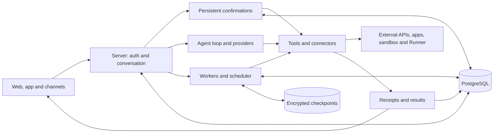

<!-- Logo goes here (light and dark versions in .github/images). -->

<h1 align="center">Brambit</h1>

<h3 align="center">The open-source engine for personal AI assistants: one server, many people, each in their own space.</h3>

<p align="center">
  <a href="LICENSE"></a>
  <a href="https://github.com/morethanrealio/brambit/actions/workflows/ci.yml"></a>
  <a href="https://github.com/morethanrealio/brambit/tags"></a>
  
</p>

<p align="center"><a href="README.pt-BR.md">Leia em português</a></p>

Brambit is software that runs on your own server and gives every person in a family,
a team or a company their own AI assistants. Open-source personal agents such as
OpenClaw, NanoClaw and Hermes Agent are built around one owner, who sets them up and
controls them. Brambit is built to be shared: one person sets it up, and everyone else
gets their own account and uses it from the browser.

People chat with their assistants in a web app and on Telegram, WhatsApp, email and
Slack. The assistants remember what matters, use connectors (Google, Microsoft, GitHub
and remote MCP servers), run code in a sandbox, build and host small apps, and run
scheduled routines. You pick the model: any provider compatible with the OpenAI API,
or Gemini, with your own key.

Brambit is the engine of [Brambs](https://brambs.com.br), the hosted service run by
the same team at More Than Real. Brambs runs this code plus its own plugins for
billing and operations.

## Why Brambit

The big tech companies are launching personal assistants that act for you: they
remember you, use your apps, work in the background and talk to you where you
already are. Brambit gives you the same kinds of features in an environment you
control: your server, the model you choose, and data stored with you. The model
provider receives the context of each call, and the optional services you turn on
(web search, image generation, voice) receive what their job needs.

- *Many people, one server.* Each person gets their own account, assistants, memory
  and connections, and their own code sandbox (one container per account). Automated
  tests check that one account can't read or change another's data through the API.
  A family, a team or a company can share one instance.
- *Everyday use happens in the browser.* People sign in to a web app, a first-run
  guide sets up their assistant, and connectors link with a button once the installer
  has registered the OAuth app for each provider. Setup and system settings stay with
  whoever installs it.
- *Asks before it acts.* Actions that write or send through connectors, channels and
  MCP tools ask for confirmation first, and the confirmation is stored and checked
  again before anything happens. Code the assistant writes runs in the person's own
  container on a separate sandbox host, which reaches the internet but not your
  private network. The Runner can run commands on a person's own computer, with
  writes confined by the kernel to the folders they allow (macOS and Linux).
- *Where people already are.* One assistant answers in the web app, Telegram,
  WhatsApp, email and Slack, and can search its own past conversations. WhatsApp and
  Slack need an app registered with Meta or Slack and a public address.
- *Your model, your key.* Choose a provider and a model for each job (chat, reading
  images, research, coding, memory) in one commented YAML file, with an optional
  fallback.
- *Extensible without forking.* Plugins add branding, pages, screens, messages and
  answers to the questions the core asks the installer (spending limits, app and disk
  quotas, who pays for an account). Without plugins, every one of those has a default
  that keeps the instance working; spending, for example, has no cap until a plugin
  sets one.

## Install on your computer

To use Brambit, not to develop it. No administrator rights and nothing to install
first: the installer brings its own Node.js.

This is the quickest way to try Brambit by yourself. It runs on one computer and
listens on `127.0.0.1` only, so other people can't reach it from their own devices
unless you share it with your household (below), and it doesn't set up the code sandbox, hosted apps, WhatsApp or Slack.

Windows (PowerShell):

```powershell
irm https://raw.githubusercontent.com/morethanrealio/brambit/main/install.ps1 | iex
```

macOS and Linux:

```bash
curl -fsSL https://raw.githubusercontent.com/morethanrealio/brambit/main/install.sh | bash
```

It installs Brambit for your user, adds a Brambit shortcut (Start menu and desktop
on Windows, Applications on macOS, the app menu on Linux), starts it with the
computer and opens the setup page in your browser: your account (you become the
owner of the installation), which AI to use and its key, tested before it is saved.
After that, sign-up is closed. Your data lives
in `~/.brambit` (or `BRAMBIT_DATA_DIR`), outside the program folder, so running the
installer again updates Brambit and keeps it. Everything listens on `127.0.0.1` only.

The `brambit` command, in a new terminal:

- `brambit open` starts it in the background if needed and opens the browser (the
  shortcut does the same).
- `brambit stop` turns it off; so does the button in Settings > This computer,
  where you can also change the AI (without turning the assistant off) and open
  System settings: voice messages, email, WhatsApp and the rest. They are saved in
  `~/.brambit/brambit.env`, with the keys encrypted, and apply while it runs.
- `brambit status` says whether it is running.
- `brambit uninstall` removes the program, the shortcuts and starting with the
  computer, and keeps your data.

From a clone of this repository, `npm ci` and then `npm run brambit` run the same
thing in the terminal window (`npm run brambit -- stop`, `npm run brambit -- status`).

### Share it with your household

Only if other people at home want their own assistant, each with their own account
and conversations. For you alone, skip this: nothing changes. Brambit keeps
listening on `127.0.0.1` only; [Tailscale](https://tailscale.com), a private network
between your devices, gives this computer an https address that only the people in
your tailnet can open, and passes it on to Brambit.

1. Install Tailscale on this computer and on the other person's phone or computer,
   and invite them to your tailnet from the Tailscale admin console.
2. On this computer, `brambit status` shows the port (`running: http://127.0.0.1:8080`);
   run `tailscale serve --bg 8080` with that port. The first time, it may ask you to
   turn on HTTPS for your tailnet. It prints the address under "Available within
   your tailnet", like `https://<computer>.<tailnet>.ts.net`. Use `serve`, never
   `funnel`, which puts it on the open internet. Tailscale publishes that address in
   public certificate logs: if the computer's name has your name or anything
   private, rename the machine in Tailscale first.
3. Run `brambit share https://<computer>.<tailnet>.ts.net` (or set
   `BRAMBIT_SHARED_URL` in System settings), then `brambit stop` and `brambit open`.
4. Ask your assistant for your invite code ("what's my invite code?"). The other
   person opens the address on their device, creates an account and types the code.
   A code lets 10 people in.

This computer has to be on, awake and running Brambit for the others to use it.
Their conversations use the AI key you set up and are stored on this computer, in
your data folder. To undo it: `brambit share off`, `tailscale serve --https=443 off`
and restart Brambit.

## Quick start

To develop Brambit. Requirements: Node.js 24 (the CI version) on Windows, macOS or Linux. The database comes
with it (Postgres 14 from npm); nothing else to install.

```bash
npm ci
cp .env.example .env
cp modelos.example.yaml modelos.yaml   # pick providers and models (explained in the file)
# add to .env the key of each provider modelos.yaml uses
npm run modelos                        # checks: job → model, and warns about missing keys
npm run local
```

`npm run local` starts a throwaway database in `.local/` (listening on `127.0.0.1` only, with a password),
applies the schema and migrations, creates a test account and starts the server.
When you see `[local] ready: http://127.0.0.1:8080`, sign in with
`test@example.com` / `brambit-local-test`. To start over, stop it (Ctrl+C) and
delete `.local/`.

For the assistant to run code (Python, shell), start the sandbox in another
terminal: `ops/sandbox-host/local.sh` (Linux with Docker; asks for `sudo` for the
firewall). It prints the two `SANDBOX_*` lines for `.env`. Details in
[`ops/sandbox-host/README.md`](ops/sandbox-host/README.md).

## Providers and models

Brambit ships no model of its own. The choice lives in `modelos.yaml`, a commented
file with three sections:

- `provedores` (providers): a nickname, the API address and the *name* of the
  `.env` variable holding the key. Any OpenAI-compatible service works without code
  (Together, OpenAI, OpenRouter, Groq, DeepSeek, local Ollama...); Gemini uses
  `tipo: gemini`.
- `funcoes` (jobs): the model for each job (chat, images, research, coding, memory,
  classification...), with an optional `reserva` (fallback) model used if the main
  one fails. A job with no line inherits `padrao` (default), so one line is enough.
- `precos` (prices): the price of a new model, so spend is recorded correctly.

Without `modelos.yaml`, the built-in routing applies and one of these keys in `.env`
is enough:

| Provider | Variable | Text model used |
| --- | --- | --- |
| Together (recommended) | `TOGETHER_API_KEY` | DeepSeek V4.1 Flash |
| OpenAI | `OPENAI_API_KEY` | gpt-5.4-mini |
| Google Gemini | `GEMINI_API_KEY` | Gemini router (3.5 Flash / 3.1 Pro) |

Either way, image generation and reading scanned PDFs use Gemini: without
`GEMINI_API_KEY` those two are off. Voice messages (speech and transcription) use
Gemini or OpenAI, whichever key is set (`BRAMBIT_AUDIO_PROVIDER` picks one when
both are). Everything else (WhatsApp, Slack,
connectors, email) switches itself off while its settings in `.env` are empty; each
block is explained in [.env.example](.env.example).

## Architecture

The backend is a modular Node.js monolith: `web/server.mjs` brings HTTP, channels,
conversations and workers together in one service. PostgreSQL stores accounts,
conversations, proposals and execution records; private coding checkpoints and model
calls are also kept on an encrypted filesystem. User apps and the sandbox run on
separate hosts; the Runner can run on the user's own machine.



The entry point resolves owner, assistant and conversation and applies the
channel's controls. In the conversational wrapper, confirmations and deterministic
controls are handled before the model is called. Native tools that need confirmation
store the proposal; the human answer re-checks target and authorization before the
effect. This does not mean every external MCP tool is behind that gate yet.

The loop picks tools and calls providers with usage accounting. Coding jobs continue
in a durable worker, with checkpoints and kernel locks; reminders have one occurrence
per firing and per-part receipts on WhatsApp. A generated answer, an accepted action
and a confirmed delivery are different states.

Coding is designed for a single host; local locks are not a distributed queue. SQL
reservations protect confirmations, routines and occurrences, but they don't make the
whole service safe to run as multiple replicas.

### Plugins and ports

Whoever installs Brambit extends the engine with plugins (`web/plugins.mjs`) without
touching the core: branding (name, site, logo), pages, screens, the message catalog
and the *ports*, points where the core asks the installer something (how much a
person may spend, which app and disk limits apply, who pays for an account). Without
a plugin, each port has a default that keeps the whole instance working.

## Repository layout

- `web/`: the server (HTTP, channels, persistence, tools). Start with `server.mjs`,
  `db.mjs` (Postgres, schema `mtr_harness`) and `auth.mjs`.
- `core-proto/`: the model-agnostic agent loop (`core.mjs`), the common provider
  contract (`provider.mjs`) and the adapters in `providers/`.
- `onboarding/`, `routines/`, `discovery/`, `deepseek/`, `billing/`: TypeScript
  sources of subsystems; builds generate versioned runtime modules in `web/`.
- `migrations/`: SQL migrations; `npm run local` applies them in order.
- `runner-go/`: the Runner, which runs commands on the user's own machine with
  kernel-level confinement.
- `ops/sandbox-host/`: the code sandbox (dedicated machine or local mode).
- `ops/apps-host/`: control plane for hosted apps (`ctl.py`, `router.py`).
- `ops/tenancy-*.mjs` and `tests/tenancy-*`: account-isolation checks. The ones in
  `tests/` and `ops/tenancy-runner-test.mjs` run in the suite; `ops/tenancy-test.mjs`
  and `ops/tenancy-write-test.mjs` probe a running server with two real sessions and
  are run by hand.
- `dev/`: `npm run local` and `npm run modelos`.
- `installer/`: the one-line installers' helpers, `npm run brambit` (Brambit on your own
  computer) and their end-to-end checks.
- `test-support/`: test suite helpers.

## Development and testing

To run it on your machine, use the [Quick start](#quick-start). Never reuse the
`.env` of a production instance for tests: boot applies the schema and starts the
configured integrations. `.env` is not versioned. Outside `npm run local`, the entry
point is `node web/server.mjs`, on `127.0.0.1:8090` by default.

Day to day, run only the tests for the area you changed (`node --test tests/<file>.test.mjs`
or the area's script); `npm test` runs the whole suite. Browser tests need
Chromium/Chrome via `CHROMIUM_PATH` when required; coding storage tests need `flock`.
Database tests use the same embedded Postgres 14:

```bash
export TEST_POSTGRES_BIN="$(node --input-type=module -e "const m=await import('./dev/local.mjs');console.log(m.postgresBin())")"
node --test tests/server-boot.test.mjs
```

That test creates its own database, isolates credentials and blocks outside access.
Don't assume the same protection for every eval script in the repository.

## Resources

- [Contributing guide](CONTRIBUTING.md) and [open work](https://github.com/morethanrealio/brambit/issues)
- [Releases](https://github.com/morethanrealio/brambit/releases) (notes up to 0.2.24 in [CHANGELOG.md](CHANGELOG.md))
- [Security policy](SECURITY.md)
- [Governance](GOVERNANCE.md) and [maintainers](MAINTAINERS.md)
- [Code of conduct](CODE_OF_CONDUCT.md)

## License

The code is [AGPL-3.0](LICENSE). Names, logos and mascots are not covered by the
license (see [GOVERNANCE.md](GOVERNANCE.md#trademark)).
