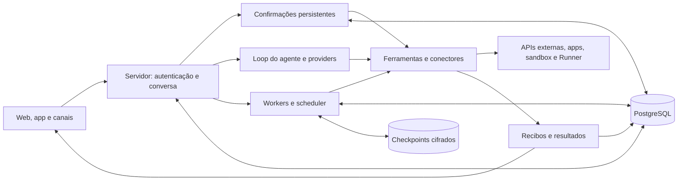

<!-- Logo vai aqui (versões clara e escura em .github/images). -->

<h1 align="center">Brambit</h1>

<h3 align="center">O motor open source de assistentes pessoais de IA: um servidor, muitas pessoas, cada uma no seu espaço.</h3>

<p align="center">
  <a href="LICENSE"></a>
  <a href="https://github.com/morethanrealio/brambit/actions/workflows/ci.yml"></a>
  <a href="https://github.com/morethanrealio/brambit/tags"></a>
  
</p>

<p align="center"><a href="README.md">Read in English</a></p>

O Brambit é um software que roda no seu próprio servidor e dá a cada pessoa de uma
família, de um time ou de uma empresa os próprios assistentes de IA. Agentes pessoais
open source como OpenClaw, NanoClaw e Hermes Agent são feitos em volta de um dono, que
configura e controla tudo. O Brambit é feito para ser compartilhado: uma pessoa instala,
e cada uma das outras ganha a própria conta e usa pelo navegador.

As pessoas conversam com os seus assistentes num app web e pelo Telegram, WhatsApp,
e-mail e Slack. Os assistentes lembram do que importa, usam conectores (Google,
Microsoft, GitHub e servidores MCP remotos), rodam código num sandbox, criam e
hospedam pequenos apps e executam rotinas agendadas. O modelo é escolha de quem
instala: qualquer provedor compatível com a API da OpenAI, ou o Gemini, com a sua
chave.

O Brambit é o motor do [Brambs](https://brambs.com.br), o serviço hospedado mantido
pelo mesmo time, na More Than Real. O Brambs roda este código mais os próprios
plugins de cobrança e operação.

## Por que o Brambit

As big techs estão lançando assistentes pessoais que agem por você: lembram de
você, usam os seus apps, trabalham em segundo plano e conversam onde você já está.
O Brambit traz os mesmos tipos de funcionalidade num ambiente que você controla: o
seu servidor, o modelo que você escolher e os dados guardados com você. O provedor
do modelo recebe o contexto de cada chamada, e os serviços opcionais que você ligar
(busca na web, geração de imagem, voz) recebem o que o trabalho deles precisa.

- *Muita gente, um servidor.* Cada pessoa tem a própria conta, assistentes,
  memória e conexões, e o próprio sandbox de código (um container por conta). Testes
  automáticos conferem que uma conta não consegue ler nem alterar os dados de outra
  pela API. Uma família, um time ou uma empresa podem dividir a mesma instância.
- *O uso do dia a dia é no navegador.* A pessoa entra num app web, um guia de
  primeiro acesso monta o assistente dela e os conectores se ligam com um botão
  depois que quem instala registra o app OAuth de cada provedor. Instalação e
  configurações do sistema ficam com quem instala.
- *Pergunta antes de agir.* Ações que gravam ou enviam por conectores, canais e
  ferramentas MCP pedem confirmação antes, e a confirmação fica guardada e é conferida
  de novo antes do efeito. O código que o assistente escreve roda no container da
  própria pessoa, numa máquina de sandbox separada, que alcança a internet mas não a
  sua rede privada. O Runner executa comandos no computador da própria pessoa, com a
  escrita confinada pelo kernel às pastas que ela liberar (macOS e Linux).
- *Onde as pessoas já estão.* O mesmo assistente responde no app web, Telegram,
  WhatsApp, e-mail e Slack, e consegue buscar nas próprias conversas anteriores.
  WhatsApp e Slack precisam de um app registrado na Meta ou no Slack e de um endereço
  público.
- *Seu modelo, sua chave.* Escolha provedor e modelo por função (conversa, leitura de
  imagem, pesquisa, programação, memória) num único YAML comentado, com reserva
  opcional.
- *Extensível sem fork.* Plugins trazem marca, páginas, telas, mensagens e as
  respostas às perguntas que o núcleo faz a quem instala (limite de gasto, teto de
  apps e disco, quem paga uma conta). Sem plugin, cada uma tem um padrão que mantém a
  instância funcionando; o gasto, por exemplo, fica sem teto até um plugin definir um.

## Instalar no seu computador

Para usar o Brambit, não para desenvolver. Não precisa ser administrador nem instalar
nada antes: o instalador traz o próprio Node.js.

É o jeito mais rápido de testar o Brambit sozinho. Ele roda num computador e escuta
só em `127.0.0.1`, então outras pessoas não alcançam ele pelos próprios aparelhos, a
não ser que você compartilhe com quem mora com você (abaixo), e não configura o sandbox de código, os apps hospedados, o WhatsApp nem o Slack.

Windows (PowerShell):

```powershell
irm https://raw.githubusercontent.com/morethanrealio/brambit/main/install.ps1 | iex
```

macOS e Linux:

```bash
curl -fsSL https://raw.githubusercontent.com/morethanrealio/brambit/main/install.sh | bash
```

Ele instala o Brambit para o seu usuário, cria o atalho do Brambit (menu Iniciar e
área de trabalho no Windows, Aplicativos no macOS, menu de apps no Linux), liga junto
com o computador e abre no navegador a página de configuração: a sua conta (você vira
a dona ou o dono da instalação), qual IA usar e a chave dela, testada antes de
salvar. Depois disso o cadastro fica fechado. Os
dados ficam em `~/.brambit` (ou em `BRAMBIT_DATA_DIR`), fora da pasta do programa,
então rodar o instalador de novo atualiza o Brambit e mantém os dados. Tudo escuta só
em `127.0.0.1`.

O comando `brambit`, num terminal novo:

- `brambit open` liga em segundo plano, se preciso, e abre o navegador (o atalho faz
  o mesmo).
- `brambit stop` desliga; o botão em Configurações > Este computador também, e lá dá
  para trocar a IA (sem desligar o assistente) e abrir as Configurações do sistema:
  mensagens de voz, e-mail, WhatsApp e o resto. Elas ficam em
  `~/.brambit/brambit.env`, com as chaves cifradas, e valem com ele ligado.
- `brambit status` diz se está ligado.
- `brambit uninstall` tira o programa, os atalhos e o ligar com o computador, e
  mantém os seus dados.

Num clone deste repositório, `npm ci` e depois `npm run brambit` fazem o mesmo na
janela do terminal (`npm run brambit -- stop`, `npm run brambit -- status`).

### Compartilhar com quem mora com você

Só se outras pessoas da casa quiserem o próprio assistente, cada uma com a sua conta
e as suas conversas. Para usar sozinho, pule esta parte: nada muda. O Brambit
continua escutando só em `127.0.0.1`; o [Tailscale](https://tailscale.com), uma rede
privada entre os seus aparelhos, dá a este computador um endereço https que só quem
está na sua tailnet abre, e repassa para o Brambit.

1. Instale o Tailscale neste computador e no celular ou computador da outra pessoa,
   e convide ela para a sua tailnet pelo painel de administração do Tailscale.
2. Neste computador, `brambit status` mostra a porta (`running: http://127.0.0.1:8080`);
   rode `tailscale serve --bg 8080` com essa porta. Na primeira vez ele pode pedir
   para ligar o HTTPS da sua tailnet. Ele mostra o endereço em "Available within
   your tailnet", algo como `https://<computador>.<tailnet>.ts.net`. Use `serve`,
   nunca `funnel`, que põe na internet aberta. O Tailscale publica esse endereço em
   logs públicos de certificados: se o nome do computador tem o seu nome ou algo
   privado, renomeie a máquina no Tailscale antes.
3. Rode `brambit share https://<computador>.<tailnet>.ts.net` (ou preencha
   `BRAMBIT_SHARED_URL` nas Configurações do sistema), depois `brambit stop` e
   `brambit open`.
4. Peça ao seu assistente o seu código de convite ("qual meu código de convite?"). A
   outra pessoa abre o endereço no aparelho dela, cria a conta e digita o código. Um
   código deixa entrar 10 pessoas.

Este computador precisa estar ligado, acordado e com o Brambit aberto para as outras
pessoas usarem. As conversas delas usam a chave de IA que você configurou e ficam
guardadas neste computador, na sua pasta de dados. Para desfazer: `brambit share
off`, `tailscale serve --https=443 off` e reinicie o Brambit.

## Quick start

Para desenvolver o Brambit. Requisitos: Node.js 24 (a versão do CI) em Windows, macOS ou Linux. O banco vem junto
(Postgres 14 pelo npm); não precisa instalar mais nada.

```bash
npm ci
cp .env.example .env
cp modelos.example.yaml modelos.yaml   # escolha provedores e modelos (explicado no arquivo)
# cole no .env a chave de cada provedor que o modelos.yaml usa
npm run modelos                        # confere: função → modelo, e avisa chave faltando
npm run local
```

O `npm run local` sobe um banco descartável em `.local/` (escutando só em `127.0.0.1`, com senha),
aplica schema e migrações, cria uma conta de teste e abre o servidor. Quando
aparecer `[local] ready: http://127.0.0.1:8080`, entre com `test@example.com` /
`brambit-local-test`. Pra recomeçar do zero, pare (Ctrl+C) e apague `.local/`.

Pra o assistente rodar código (python, shell), suba o sandbox num outro
terminal: `ops/sandbox-host/local.sh` (Linux com Docker; pede `sudo` pro
firewall). Ele imprime as duas linhas `SANDBOX_*` pro `.env`. Detalhe em
[`ops/sandbox-host/README.md`](ops/sandbox-host/README.md).

## Provedores e modelos

O Brambit não traz modelo próprio. A escolha fica no `modelos.yaml`, um arquivo comentado com três seções:

- `provedores`: apelido, endereço da API e o *nome* da variável do `.env` com a
  chave. Qualquer serviço compatível com a API da OpenAI entra sem código
  (Together, OpenAI, OpenRouter, Groq, DeepSeek, Ollama local...); o Gemini entra
  com `tipo: gemini`.
- `funcoes`: o modelo de cada função (conversa, imagem, pesquisa, programação,
  memória, classificação...), com um modelo `reserva` opcional que entra se o
  principal cair. Função sem linha herda do `padrao`, então uma linha basta.
- `precos`: preço de modelo novo, pra o registro de gasto sair certo.

Sem `modelos.yaml`, vale o roteamento embutido, e basta uma destas chaves no `.env`:

| Provedor | Variável | Modelo de texto usado |
| --- | --- | --- |
| Together (recomendado) | `TOGETHER_API_KEY` | DeepSeek V4.1 Flash |
| OpenAI | `OPENAI_API_KEY` | gpt-5.4-mini |
| Google Gemini | `GEMINI_API_KEY` | roteador do Gemini (3.5 Flash / 3.1 Pro) |

Nos dois caminhos, gerar imagem e ler PDF escaneado usam o Gemini: sem
`GEMINI_API_KEY` esses dois ficam desligados. Mensagens de voz (falar e transcrever)
usam o Gemini ou a OpenAI, conforme a chave que estiver no `.env`
(`BRAMBIT_AUDIO_PROVIDER` escolhe quando as duas estão). O resto (WhatsApp, Slack,
conectores, e-mail) desliga sozinho enquanto a configuração dele estiver vazia
no `.env`; cada bloco está explicado no [.env.example](.env.example).

## Arquitetura

O backend é um monólito Node.js modular: `web/server.mjs` integra HTTP, canais,
conversas e workers no mesmo serviço. PostgreSQL guarda contas, conversas,
propostas e registros de execução; checkpoints privados de programação e chamadas
de modelo também ficam em filesystem cifrado. Os apps dos usuários e o sandbox
executam em hosts separados; o Runner pode executar na máquina do próprio usuário.



A entrada resolve dono/assistente/conversa e aplica os controles do canal. No
wrapper conversacional, confirmações e controles determinísticos são tratados
antes de chamar o modelo. Ferramentas nativas sujeitas a confirmação persistem a
proposta; a resposta humana revalida alvo e autorização antes do efeito. Isso não
significa que toda ferramenta externa MCP já esteja protegida por esse gate.

O loop escolhe ferramentas e chama providers com contabilização de uso. Trabalhos
de programação continuam em worker durável, com checkpoints e locks de kernel;
lembretes têm uma ocorrência por disparo e recibos por parte no WhatsApp. Uma
resposta gerada, uma ação aceita e uma entrega confirmada são estados diferentes.

O desenho de programação é de um único host; locks locais não são uma fila
distribuída. Reservas SQL protegem confirmações, rotinas e ocorrências, mas não
tornam todo o serviço apto a múltiplas réplicas.

### Plugins e portas

Quem instala o Brambit estende o motor por plugins (`web/plugins.mjs`), sem mexer
no núcleo: marca (nome, site, logo), páginas, telas, catálogo de mensagens e as
*portas*, pontos onde o núcleo pergunta algo a quem instalou (quanto a pessoa
pode gastar, que limites de apps e disco valem, quem paga uma conta). Sem plugin,
cada porta tem um padrão que deixa a instância inteira funcionando.

## Estrutura do repositório

- `web/`: servidor (HTTP, canais, persistência, ferramentas). Começar por
  `server.mjs`, `db.mjs` (Postgres, schema `mtr_harness`) e `auth.mjs`.
- `core-proto/`: loop de agente model-agnostic (`core.mjs`), contrato comum de
  provider (`provider.mjs`) e os adapters em `providers/`.
- `onboarding/`, `routines/`, `discovery/`, `deepseek/`, `billing/`: fontes
  TypeScript de subsistemas; os builds geram módulos runtime versionados em `web/`.
- `migrations/`: SQL de migração; o `npm run local` aplica em ordem.
- `runner-go/`: o Runner, que executa comandos na máquina do próprio usuário, com
  confinamento no kernel.
- `ops/sandbox-host/`: sandbox de código (máquina dedicada ou modo local).
- `ops/apps-host/`: plano de controle dos apps hospedados (`ctl.py`, `router.py`).
- `ops/tenancy-*.mjs` e `tests/tenancy-*`: checagens de isolamento entre contas. As
  de `tests/` e o `ops/tenancy-runner-test.mjs` rodam na suíte; `ops/tenancy-test.mjs`
  e `ops/tenancy-write-test.mjs` testam um servidor no ar com duas sessões reais e
  rodam à mão.
- `dev/`: `npm run local` e `npm run modelos`.
- `installer/`: o que os instaladores de uma linha usam, o `npm run brambit` (Brambit no
  seu computador) e as provas de ponta a ponta deles.
- `test-support/`: apoio da suíte de testes.

## Desenvolvimento e validação

Pra rodar na sua máquina, use o [Quick start](#quick-start). Nunca reutilize o
`.env` de uma instância em produção para testes: o boot aplica schema e inicia
as integrações configuradas. O `.env` não é versionado. Fora do `npm run local`,
o entrypoint é `node web/server.mjs`, por padrão em `127.0.0.1:8090`.

Na rotina, rode só os testes da área que mudou (`node --test tests/<arquivo>.test.mjs` ou
o script da área); `npm test` roda a suíte inteira. Testes de navegador exigem
Chromium/Chrome via `CHROMIUM_PATH` quando necessário; testes de armazenamento de
programação precisam de `flock`. Os testes com banco usam o mesmo Postgres 14
embutido:

```bash
export TEST_POSTGRES_BIN="$(node --input-type=module -e "const m=await import('./dev/local.mjs');console.log(m.postgresBin())")"
node --test tests/server-boot.test.mjs
```

Esse teste cria seu próprio banco, isola credenciais e bloqueia acessos externos.
Essa proteção não deve ser presumida para qualquer script de eval do repositório.

## Recursos

- [Guia de contribuição](CONTRIBUTING.md) e [trabalho em aberto](https://github.com/morethanrealio/brambit/issues)
- [Changelog](CHANGELOG.md)
- [Política de segurança](SECURITY.md)
- [Governança](GOVERNANCE.md) e [mantenedores](MAINTAINERS.md)
- [Código de conduta](CODE_OF_CONDUCT.md)

Os documentos da comunidade estão em inglês.

## Licença

O código é [AGPL-3.0](LICENSE). Nomes, logos e mascotes ficam fora da licença
(ver [GOVERNANCE.md](GOVERNANCE.md#trademark)).
